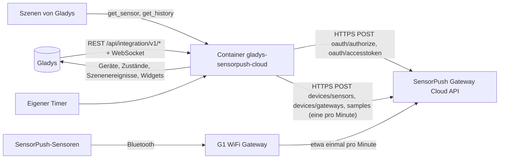
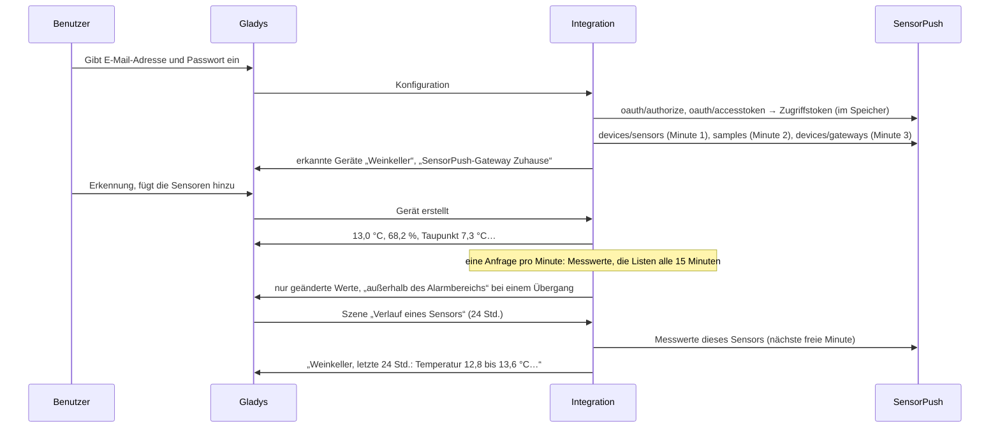
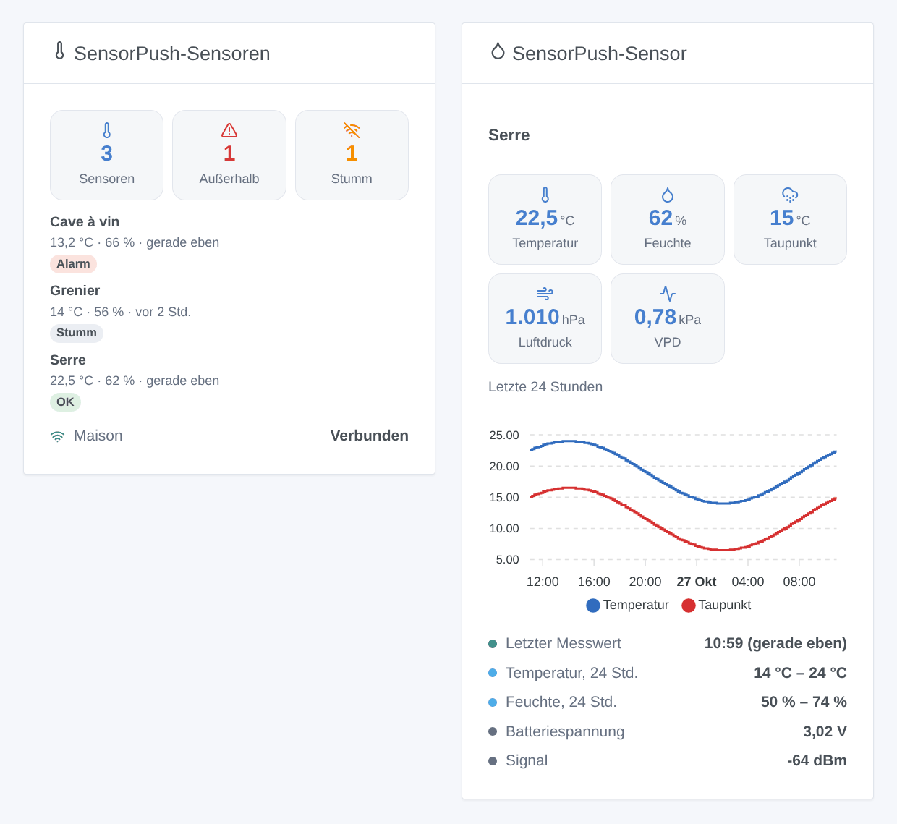

# Gladys SensorPush Cloud

[English](README.md) · [Français](README.fr.md) · **Deutsch** · [Español](README.es.md)

[](LICENSE)
[](https://github.com/William-De71/gladys-sensorpush-cloud/releases)
[](https://github.com/William-De71/gladys-sensorpush-cloud/actions/workflows/release.yml)
[](https://gladysassistant.com)


Externe Integration von [Gladys Assistant](https://gladysassistant.com) für die Temperatur- und Feuchtesensoren von **SensorPush**, über die offizielle [SensorPush Gateway Cloud API](https://www.sensorpush.com/gateway-cloud-api) mit der E-Mail-Adresse und dem Passwort deines SensorPush-Kontos. Sie zeigt in Gladys Temperatur, Luftfeuchtigkeit, Taupunkt, Luftdruck und VPD jedes Sensors, ob jedes Gateway online ist, und löst Szenen aus, wenn ein Wert den in der SensorPush-App eingestellten Alarmbereich verlässt, ein Sensor verstummt oder ein Gateway ausfällt — nur lesend.

Benutzerdokumentation: [English](docs/en.md) · [Français](docs/fr.md) · [Deutsch](docs/de.md) · [Español](docs/es.md).

Nicht mit SensorPush verbunden. **Noch nicht mit einem echten SensorPush-Konto getestet**: Anfragen, Felder und Einheiten folgen der offiziellen Swagger-Definition; die Antworten auf ein unbekanntes Konto, ein zu kurzes Passwort und ein falsches Token wurden live geprüft.

## Funktionen

- Jeder **aktive Sensor** des Kontos (HT1, HT.w, HTP.xw) und jedes **Gateway**, von selbst gefunden.
- **Ein Gerät pro Sensor**: Temperatur, Luftfeuchtigkeit, Taupunkt, Luftdruck (HTP.xw) und Dampfdruckdefizit (VPD), umgerechnet aus °F und inHg; **ein Gerät pro Gateway**: seine Verbindung und Softwareversion.
- **7 Szenenauslöser** (außerhalb des Alarmbereichs, zurück im Alarmbereich, Sensor stumm, Sensor wieder da, Gateway getrennt, Gateway wieder verbunden, Zugriff verweigert), **2 Szenenaktionen** (Werte eines Sensors, Verlauf eines Sensors über 1 bis 72 Stunden) und **2 Dashboard-Widgets** (alle Sensoren auf einen Blick, ein Sensor mit einem 24-Stunden-Diagramm).
- **Nie mehr als eine Anfrage pro Minute**, die von SensorPush dokumentierte Grenze; die letzten Messwerte standardmäßig jede Minute.
- **Nur lesend**: eine Anmeldung, dann nur lesende Anfragen; im SensorPush-Konto wird nie etwas geändert. Passwort und Token werden nie nach `/data` geschrieben.
- Vier Sprachen überall: Englisch, Französisch, Deutsch, Spanisch.

## Funktionsweise




Vom Konto zur Szene:



### Transport

`transports: ["cloud"]`: Alles läuft über die SensorPush-Cloud (`api.sensorpush.com`), die die Messwerte der Sensoren über das Gateway erhält. **E-Mail-Adresse und Passwort verlassen dein Netzwerk** (nur zu SensorPush, zur Anmeldung); die Messwerte deiner Sensoren kommen von SensorPush. `/data` speichert einen Fingerabdruck der E-Mail-Adresse, die Sensoren, die Gateways, ihre letzten Messwerte, einen Punkt alle 10 Minuten über 24 Stunden für das Diagramm und was die Auslöser wissen — nie Passwort oder Token.

## Geräte und Funktionen

| Gerät            | Funktionen (Kategorie / Typ)                                                                                                                                                                                                                            |
| ---------------- | ------------------------------------------------------------------------------------------------------------------------------------------------------------------------------------------------------------------------------------------------------- |
| Eins pro Sensor  | Temperatur (`temperature-sensor` / `decimal`, °C), Luftfeuchtigkeit (`humidity-sensor` / `decimal`, %), Taupunkt (`temperature-sensor` / `probe`, °C), Luftdruck (`pressure-sensor` / `decimal`, hPa, HTP.xw), VPD (`pressure-sensor` / `decimal`, kPa) |
| Eins pro Gateway | Verbindung und Version (`text` / `text`)                                                                                                                                                                                                                |

- SensorPush liefert °F und inHg: Die Integration rechnet sie in °C und hPa um, und Gladys zeigt sie in den Einheiten jedes Benutzers.
- Der Taupunkt ist eine `probe`-Temperatur (Fühler): Er fließt nicht in die Durchschnittstemperatur des Raums ein.
- Ältere Sensoren liefern weder Taupunkt noch VPD, nur der HTP.xw hat ein Barometer: Eine Funktion erscheint mit ihrem ersten Wert und bleibt dann.
- Batteriespannung und Signal (dBm) haben im Kern keine passende Kategorie (die Batterie ist ein Prozentwert, das Signal eine Qualität von 0 bis 5): Das Sensor-Widget und die Szenenaktion zeigen sie.
- Ein Gateway ist verbunden, solange es sich in den letzten 30 Minuten bei der Cloud gemeldet hat (SensorPush empfiehlt, `last_seen` etwa alle 15 Minuten zu lesen).
- Die External IDs beruhen auf der ID des Sensors und dem Schlüssel des Gateways (`ext:…:sensor:16855-27453475893`: ein Punkt wird zum Bindestrich).

## Szenenauslöser, Aktionen und Widgets



**Widgets**: SensorPush-Sensoren (wie viele Sensoren, außerhalb, stumm; eine Karte pro Sensor, Alarme zuerst, mit Temperatur, Luftfeuchtigkeit und Alter des letzten Messwerts; die Gateways) und SensorPush-Sensor (seine Messwerte, Temperatur und Taupunkt der letzten 24 Stunden, Minimum und Maximum des Tages, seine Alarmbereiche, Batteriespannung und Signal). Beide folgen den Einheiten des Benutzers, der sie ansieht.

**Auslöser** (ein Ereignis pro Übergang, nie beim ersten Lesen, nie als Folge einer Aktion):

- **außerhalb des Alarmbereichs** / **zurück im Alarmbereich**: Temperatur oder Luftfeuchtigkeit überschreitet den in der SensorPush-App eingestellten Alarmbereich (Filter: Sensor, Messwerte, Seite); Variablen: der Wert, seine Einheit, der Bereich, die Seite, die Dauer außerhalb;
- **Sensor stumm** / **Sensor wieder da**: kein neuer Messwert während der eingestellten Zeit (standardmäßig 30 Minuten), dann wieder Messwerte, mit der Dauer;
- **Gateway getrennt** / **Gateway wieder verbunden**: 30 Minuten keine Meldung, dann wieder eine Meldung (Filter: Gateway);
- **Zugriff verweigert**: SensorPush lehnt E-Mail-Adresse, Passwort oder Token ab — einmal pro Ablehnung.

Die Werte sind Gerätefunktionen: „Luftfeuchtigkeit über 70 %“ ist ein Geräteauslöser von Gladys, mit deinem eigenen Schwellenwert.

**Aktionen**:

- **Werte eines Sensors**: die letzten Werte, Batteriespannung, Signal und ein Satz, aus der letzten Abfrage (ohne Anfrage).
- **Verlauf eines Sensors**: minimale, maximale und mittlere Temperatur und Luftfeuchtigkeit der letzten 1 bis 72 Stunden, in einer Anfrage in der nächsten freien Minute.

Bewusst nicht umgesetzt: kein Schreiben (Gladys braucht die Tags der API nicht), keine Massenberichte (von SensorPush per E-Mail verschickt), keine Funktion für die Batteriespannung (keine Kategorie im Kern).

Beispiele:

- Wenn **SensorPush: außerhalb des Alarmbereichs** beim Weinkeller → „{{triggerEvent.data.sensor_name}}: {{triggerEvent.data.measure_label}} {{triggerEvent.data.value}} {{triggerEvent.data.unit}}“ senden.
- Jeden Tag um 8:00 → **SensorPush: Verlauf eines Sensors** (Gewächshaus, 24 Std.) → die Zusammenfassung senden.
- Wenn **SensorPush: Gateway getrennt** → „Das SensorPush-Gateway {{triggerEvent.data.gateway_name}} ist offline“ senden.

## Voraussetzungen

- Gladys Assistant **5.3.0** oder neuer (Widgets und Szenen der Integrationen, Katalog-Schlüsselwörter von Gladys 5.3): Ältere Instanzen können die Integration nicht installieren.
- Ein SensorPush-Konto mit mindestens einem Sensor und einem **SensorPush-Gateway** (G1 WiFi Gateway): Ohne Gateway erreichen die Messwerte nie die Cloud.
- **Der API-Zugang aktiviert**: Melde dich einmal im [Gateway Cloud Dashboard](https://dashboard.sensorpush.com/) an und akzeptiere die API-Bedingungen.
- Internet: Die Integration spricht nur mit `api.sensorpush.com`.

### Das Tempo der API

SensorPush dokumentiert „nicht mehr als eine Anfrage pro Minute“. Die Integration hält jede Datenanfrage mindestens 61 Sekunden auseinander: der letzte Messwert jedes Sensors im eingestellten Intervall (standardmäßig jede Minute, eine Anfrage für alle), die Liste der Sensoren und Gateways alle 15 Minuten, jeweils anstelle einer Messwertabfrage, und die Verlaufsaktion in der nächsten freien Minute. Die beiden Anmeldeanfragen kommen nur, wenn das Zugriffstoken abläuft (sein `exp`, eine Stunde). Nach einem 429, einem 5xx oder ohne Antwort warten alle Anfragen 2 Minuten, verdoppelt bis 30 Minuten (oder der Retry-After).

## Installation

- **Aus dem Store**: Integrationen → SensorPush Cloud → Installieren.
- **Über die URL des Repositorys**: Integrationen → externe Integration → `https://github.com/William-De71/gladys-sensorpush-cloud`.
- **Entwicklermodus**: `npm start` mit den von Gladys gegebenen Variablen starten (siehe Entwicklung).

## Konfiguration

| Feld oder Schaltfläche       | Standard    | Bedeutung                                                                                   |
| ---------------------------- | ----------- | ------------------------------------------------------------------------------------------- |
| E-Mail-Adresse               | —           | Pflicht: die E-Mail des SensorPush-Kontos                                                   |
| Passwort                     | —           | Pflicht, ein Geheimnis: nie wieder angezeigt, nie geloggt, nie nach `/data` geschrieben     |
| Abfrage der Messwerte        | 1 Min.      | 1, 2, 5 oder 10 Min.: eine Anfrage für alle Sensoren                                        |
| Sensor stumm nach            | 30 Min.     | 15, 30, 60, 120 oder 360 Min. ohne neuen Messwert                                           |
| Einheiten der Szenen         | metrisch    | Metrisch (°C, hPa) oder US (°F, inHg) für die Werte und Texte der Szenen                    |
| Sprache der Texte            | automatisch | Namen der Funktionen, Gateway-Zustand, Szenentexte und Fehler                               |
| Verbindung testen / Diagnose | —           | Eine Anmeldung und die Liste der Sensoren; der Zustand in den Logs, ohne Passwort und Token |

## Verwendung

1. Melde dich einmal im Gateway Cloud Dashboard an und akzeptiere die API-Bedingungen (einmal pro Konto).
2. In Gladys (Integrationen → SensorPush Cloud → Konfiguration): E-Mail-Adresse und Passwort eingeben; **Verbindung testen** drücken.
3. **Erkennung**, dann deine Sensoren und Gateways als Geräte hinzufügen.
4. Die Widgets zu einem Dashboard hinzufügen, Szenen mit den Funktionen, Auslösern und Aktionen bauen.

## Entwicklung

```bash
npm install
npm test                       # node --test, ein falsches SensorPush (fetch im Speicher, falsche Uhr), nie das Netzwerk
npm run lint                   # ESLint
npm run format:check           # Prettier
npx github:GladysAssistant/integration-store . --skip-image-check
scripts/build-cover.sh         # cover.jpg aus docs/assets/cover.svg
docs/illustrations/render.sh   # docs/assets/widgets.<sprache>.png
```

Lokal liest das SDK `GLADYS_HOST_API_URL`, `GLADYS_INTEGRATION_TOKEN` und `GLADYS_INTEGRATION_SELECTOR` (von Gladys im Entwicklermodus gegeben), und die Integration liest `TZ`. `DEBUG=gladys-integration-sdk` zeigt die Logs des SDK.

Die Tests decken den HTTP-Client ab (die Anmeldung, die live gesehenen Ablehnungen, eine neue Anmeldung für ein abgelehntes Token, die Pausen, eine Datenanfrage pro Minute), die Parser und Einheitenumrechnungen, die Auslöser, die Geräte (die Felder, die der Erkennungsbildschirm verlangt, die Kategorie-/Typ-Paare des Kerns), die Widgets (`validateWidgetContent`), das Manifest, die vier Sprachen, das Release-Skript und die ganze Integration gegen das falsche Gladys des SDK und ein falsches SensorPush über eine simulierte Stunde. `test/structure.test.js` friert jeden Schlüssel ein, den Benutzer speichern.

## Release-Prozess


Jeder Merge auf `main` startet die CI und berechnet dann die Version aus den [Conventional Commits](https://www.conventionalcommits.org/) seit dem letzten Tag: `feat` → Minor, `fix` / `perf` → Patch, `!` oder `BREAKING CHANGE` → Major (ein Minor unter 1.0.0); `docs`, `chore`, `ci`, `test`, `style`, `refactor`, `build` allein veröffentlichen nichts. Der Changelog-Abschnitt wird erzeugt, der Tag gepusht, das Multi-Architektur-Image gebaut, dann erhält `main` den Release-Commit, die GitHub Release wird erstellt und ein letzter Job prüft das öffentliche Image, den Store-Validator und das Topic.

- Der Titel des Pull Requests wird zum Squash-Commit, dann zur Changelog-Zeile: Schreib ihn auf Englisch, für den Benutzer (`pr-title.yml` prüft ihn). Bearbeite `CHANGELOG.md` nie von Hand.
- 1.0.0 ist eine Entscheidung: Actions → Release → Run workflow mit `release-as: 1.0.0`. `dry-run` zeigt Version und Notizen, ohne zu veröffentlichen.
- **Geschützter Branch**: Das Release pusht seinen Commit mit `GITHUB_TOKEN` auf `main`. Das Ruleset `protect-main` (kein Löschen, kein Force-Push) lässt ihn durch; eine strengere Regel (Pull Request Pflicht, Status Checks) bräuchte GitHub Actions in der Bypass-Liste oder eine GitHub App.
- Nach dem ersten Release das `ghcr.io`-Paket öffentlich machen (Package settings → Change visibility), sonst kann Gladys es nicht laden.

## Fehlerbehebung

Siehe [docs/de.md](docs/de.md#fehlerbehebung). Melde Probleme mit den Versionen von Gladys und der Integration, deinen Sensor- und Gateway-Modellen, der Meldung von **Verbindung testen** und dem Ergebnis von **Diagnose** (in den Logs der Integration). Füge nie dein Passwort ein.

## Mitwirken

Issues und Pull Requests sind willkommen. Führe `npm run format:check && npm run lint && npm test` aus, bevor du einen Pull Request öffnest, und lass jede External ID und jeden gespeicherten Schlüssel unverändert (siehe [CLAUDE.md](CLAUDE.md)).

## Sicherheit

Siehe [SECURITY.md](SECURITY.md): Melde Schwachstellen vertraulich. Das Passwort ist ein `secret`-Feld: nie geloggt, nie nach `/data` geschrieben, nur an `api.sensorpush.com` gesendet, zur Anmeldung. Das Zugriffstoken bleibt im Speicher, wird nie geloggt und nur an `api.sensorpush.com` gesendet. `/data/sensorpush.json` wird mit Modus 0600 geschrieben.

## Kommende Screenshots

Die Bilder oben sind Illustrationen, keine Screenshots. Echte Screenshots kommen nach `docs/assets/screenshots/` (PNG, 1280 × 800): `configuration.png`, `discovery.png` (die angebotenen Sensoren und Gateways), `device.png` (ein Sensor mit seinen Funktionen), `scene-out-of-range.png` (eine Szene mit dem Auslöser „außerhalb des Alarmbereichs“), `dashboard.png` (die beiden Widgets mit echten Sensoren).

## Lizenz

[Apache-Lizenz 2.0](LICENSE) — siehe auch [NOTICE](NOTICE). SensorPush ist eine Marke ihres Inhabers. Danke an die Dokumentation und das SDK von Gladys, an SensorPush für die öffentliche Definition seiner API und an die Autoren der Home-Assistant-Integration „SensorPush Cloud“.
