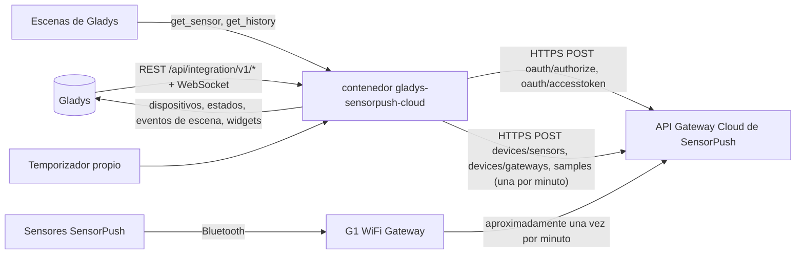
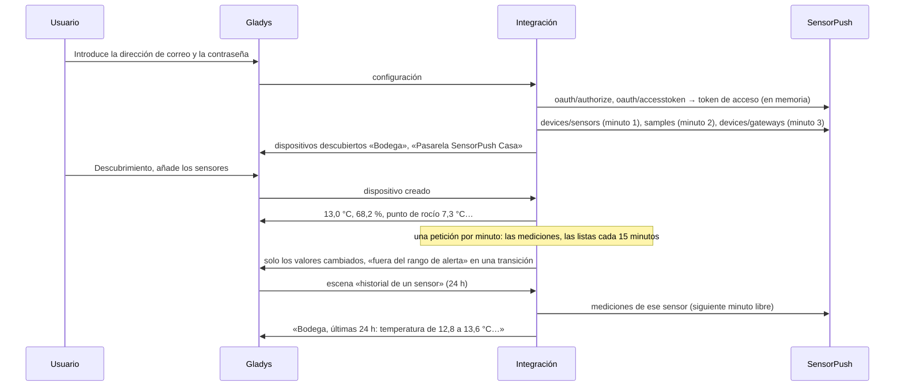
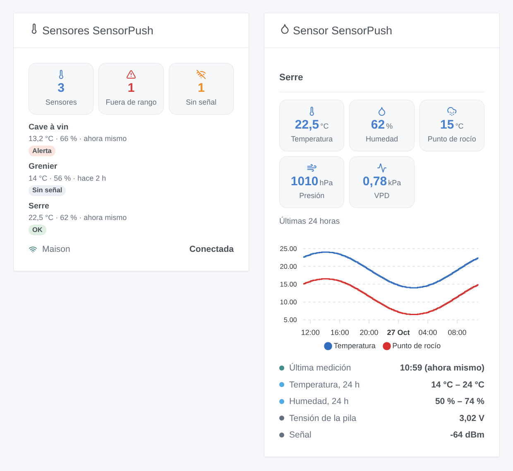

# Gladys SensorPush Cloud

[English](README.md) · [Français](README.fr.md) · [Deutsch](README.de.md) · **Español**

[](LICENSE)
[](https://github.com/William-De71/gladys-sensorpush-cloud/releases)
[](https://github.com/William-De71/gladys-sensorpush-cloud/actions/workflows/release.yml)
[](https://gladysassistant.com)


Integración externa de [Gladys Assistant](https://gladysassistant.com) para los sensores de temperatura y humedad **SensorPush**, a través de la [API oficial Gateway Cloud de SensorPush](https://www.sensorpush.com/gateway-cloud-api) y la dirección de correo y la contraseña de su cuenta SensorPush. Muestra en Gladys la temperatura, la humedad, el punto de rocío, la presión y el VPD de cada sensor, si cada pasarela está conectada, y lanza escenas cuando un valor sale del rango de alerta configurado en la aplicación SensorPush, un sensor deja de enviar o una pasarela se cae — solo lectura.

Documentación de usuario: [English](docs/en.md) · [Français](docs/fr.md) · [Deutsch](docs/de.md) · [Español](docs/es.md).

No afiliada a SensorPush. **Todavía no probada con una cuenta SensorPush real**: las peticiones, los campos y las unidades siguen la definición Swagger oficial; las respuestas a una cuenta desconocida, a una contraseña demasiado corta y a un token erróneo se comprobaron en directo.

## Funciones

- Cada **sensor activo** de la cuenta (HT1, HT.w, HTP.xw) y cada **pasarela**, encontrados solos.
- **Un dispositivo por sensor**: temperatura, humedad, punto de rocío, presión atmosférica (HTP.xw) y déficit de presión de vapor (VPD), convertidos desde °F e inHg; **un dispositivo por pasarela**: su conexión y su versión de software.
- **7 disparadores de escena** (fuera del rango de alerta, de vuelta en el rango, sensor sin señal, sensor de vuelta, pasarela desconectada, pasarela reconectada, acceso rechazado), **2 acciones de escena** (valores de un sensor, historial de un sensor de 1 a 72 horas) y **2 widgets** (todos los sensores de un vistazo, un sensor con una gráfica de 24 horas).
- **Nunca más de una petición por minuto**, el límite documentado por SensorPush; las últimas mediciones cada minuto por defecto.
- **Solo lectura**: un inicio de sesión y luego solo peticiones de lectura; nunca se modifica nada en la cuenta SensorPush. La contraseña y el token nunca se escriben en `/data`.
- Cuatro idiomas en todas partes: inglés, francés, alemán, español.

## Cómo funciona




De la cuenta a una escena:



### Transporte

`transports: ["cloud"]`: todo pasa por la nube SensorPush (`api.sensorpush.com`), que recibe las mediciones de los sensores a través de la pasarela. **La dirección de correo y la contraseña salen de su red** (solo hacia SensorPush, para iniciar sesión); las mediciones de sus sensores vienen de SensorPush. `/data` guarda una huella de la dirección de correo, los sensores, las pasarelas, sus últimas mediciones, un punto cada 10 minutos durante 24 horas para la gráfica, y lo que saben los disparadores — nunca la contraseña ni el token.

## Dispositivos y funciones

| Dispositivo      | Funciones (categoría / tipo)                                                                                                                                                                                                                                    |
| ---------------- | --------------------------------------------------------------------------------------------------------------------------------------------------------------------------------------------------------------------------------------------------------------- |
| Uno por sensor   | Temperatura (`temperature-sensor` / `decimal`, °C), humedad (`humidity-sensor` / `decimal`, %), punto de rocío (`temperature-sensor` / `probe`, °C), presión atmosférica (`pressure-sensor` / `decimal`, hPa, HTP.xw), VPD (`pressure-sensor` / `decimal`, kPa) |
| Uno por pasarela | Conexión y versión (`text` / `text`)                                                                                                                                                                                                                            |

- SensorPush da °F e inHg: la integración los convierte a °C y hPa, y Gladys los muestra en las unidades de cada usuario.
- El punto de rocío es una temperatura `probe` (sonda): no cuenta en la temperatura media de la habitación.
- Los sensores más antiguos no dan punto de rocío ni VPD, solo el HTP.xw tiene barómetro: una función aparece con su primer valor y luego se queda.
- La tensión de la pila y la señal (dBm) no tienen una categoría adecuada en el núcleo (la batería es un porcentaje, la señal una calidad de 0 a 5): el widget del sensor y la acción de escena las muestran.
- Una pasarela está conectada mientras se haya comunicado con la nube en los últimos 30 minutos (SensorPush aconseja leer `last_seen` aproximadamente cada 15 minutos).
- Los external ids se basan en el identificador del sensor y la clave de la pasarela (`ext:…:sensor:16855-27453475893`: un punto pasa a ser un guion).

## Disparadores, acciones de escena y widgets



**Widgets**: Sensores SensorPush (cuántos sensores, fuera de rango, sin señal; una tarjeta por sensor, las alertas primero, con temperatura, humedad y antigüedad de la última medición; las pasarelas) y Sensor SensorPush (sus mediciones, la temperatura y el punto de rocío de las últimas 24 horas, el mínimo y el máximo del día, sus rangos de alerta, la tensión de la pila y la señal). Ambos siguen las unidades del usuario que los mira.

**Disparadores** (un evento por transición, nunca en la primera lectura, nunca como resultado de una acción):

- **fuera del rango de alerta** / **de vuelta en el rango**: la temperatura o la humedad cruza el rango de alerta configurado en la aplicación SensorPush (filtros: sensor, medidas, lado); variables: el valor, su unidad, el rango, el lado, el tiempo fuera;
- **sensor sin señal** / **sensor de vuelta**: ninguna medición nueva durante el plazo de la configuración (30 minutos por defecto), luego de nuevo mediciones, con la duración;
- **pasarela desconectada** / **pasarela reconectada**: ninguna comunicación durante 30 minutos, luego de nuevo una comunicación (filtro: pasarela);
- **acceso rechazado**: SensorPush rechaza la dirección de correo, la contraseña o el token — una vez por rechazo.

Los valores son funciones de dispositivo: «humedad por encima del 70 %» es un disparador de dispositivo de Gladys, con su propio umbral.

**Acciones**:

- **valores de un sensor**: los últimos valores, la tensión de la pila, la señal y una frase, de la última lectura (sin petición).
- **historial de un sensor**: temperatura y humedad mínimas, máximas y medias de las últimas 1 a 72 horas, en una petición enviada en el siguiente minuto libre.

No hecho, a propósito: ninguna escritura (Gladys no necesita las etiquetas de la API), ningún informe masivo (enviado por correo por SensorPush), ninguna función para la tensión de la pila (sin categoría en el núcleo).

Ejemplos:

- Cuando **SensorPush: fuera del rango de alerta** en la bodega → enviar «{{triggerEvent.data.sensor_name}}: {{triggerEvent.data.measure_label}} {{triggerEvent.data.value}} {{triggerEvent.data.unit}}».
- Cada día a las 8:00 → **SensorPush: historial de un sensor** (invernadero, 24 h) → enviar su resumen.
- Cuando **SensorPush: pasarela desconectada** → enviar «La pasarela SensorPush {{triggerEvent.data.gateway_name}} está desconectada».

## Requisitos

- Gladys Assistant **5.3.0** o posterior (widgets y escenas de las integraciones, palabras clave del catálogo de Gladys 5.3): las instancias más antiguas no pueden instalar la integración.
- Una cuenta SensorPush con al menos un sensor y una **pasarela SensorPush** (G1 WiFi Gateway): sin ella, las mediciones nunca llegan a la nube.
- **El acceso a la API activado**: conéctese una vez al [Gateway Cloud Dashboard](https://dashboard.sensorpush.com/) y acepte las condiciones de la API.
- Internet: la integración solo habla con `api.sensorpush.com`.

### El ritmo de la API

SensorPush documenta «no más de una petición por minuto». La integración separa cada petición de datos al menos 61 segundos: la última medición de cada sensor al intervalo de la configuración (cada minuto por defecto, una sola petición para todos), la lista de sensores y pasarelas cada 15 minutos, cada una en lugar de una lectura de mediciones, y la acción de historial en el siguiente minuto libre. Las dos peticiones de inicio de sesión solo llegan cuando el token de acceso caduca (su `exp`, una hora). Tras un 429, un 5xx o una falta de respuesta, todas las peticiones esperan 2 minutos, el doble cada vez hasta 30 minutos (o el Retry-After).

## Instalación

- **Desde la tienda**: Integraciones → SensorPush Cloud → Instalar.
- **Desde la URL del repositorio**: Integraciones → integración externa → `https://github.com/William-De71/gladys-sensorpush-cloud`.
- **Modo desarrollador**: ejecute `npm start` con las variables que da Gladys (vea Desarrollo).

## Configuración

| Campo o botón                    | Por defecto | Significado                                                                                        |
| -------------------------------- | ----------- | -------------------------------------------------------------------------------------------------- |
| Dirección de correo              | —           | Obligatorio: el correo de la cuenta SensorPush                                                     |
| Contraseña                       | —           | Obligatorio, un secreto: nunca se vuelve a mostrar, nunca se registra, nunca se escribe en `/data` |
| Lectura de las mediciones        | 1 min       | 1, 2, 5 o 10 min: una sola petición para todos los sensores                                        |
| Sensor sin señal después de      | 30 min      | 15, 30, 60, 120 o 360 min sin una nueva medición                                                   |
| Unidades de las escenas          | métrico     | Métrico (°C, hPa) o EE. UU. (°F, inHg) para los valores y textos de las escenas                    |
| Idioma de los textos             | automático  | Nombres de las funciones, estado de las pasarelas, textos de escenas y errores                     |
| Probar la conexión / Diagnóstico | —           | Un inicio de sesión y la lista de sensores; el estado en los registros, sin contraseña ni token    |

## Uso

1. Conéctese una vez al Gateway Cloud Dashboard y acepte las condiciones de la API (una vez por cuenta).
2. En Gladys (Integraciones → SensorPush Cloud → Configuración): introduzca la dirección de correo y la contraseña; pulse **Probar la conexión**.
3. **Descubrimiento**, luego añada sus sensores y pasarelas como dispositivos.
4. Añada los widgets a un panel, cree escenas con las funciones, los disparadores y las acciones.

## Desarrollo

```bash
npm install
npm test                       # node --test, un SensorPush falso (fetch en memoria, reloj falso), nunca la red
npm run lint                   # ESLint
npm run format:check           # Prettier
npx github:GladysAssistant/integration-store . --skip-image-check
scripts/build-cover.sh         # cover.jpg desde docs/assets/cover.svg
docs/illustrations/render.sh   # docs/assets/widgets.<idioma>.png
```

En local, el SDK lee `GLADYS_HOST_API_URL`, `GLADYS_INTEGRATION_TOKEN` y `GLADYS_INTEGRATION_SELECTOR` (dados por Gladys en modo desarrollador), y la integración lee `TZ`. `DEBUG=gladys-integration-sdk` muestra los registros del SDK.

Las pruebas cubren el cliente HTTP (el inicio de sesión, los rechazos vistos en directo, un nuevo inicio de sesión para un token rechazado, las pausas, una petición de datos por minuto), los analizadores y las conversiones de unidades, los disparadores, los dispositivos (los campos que exige la pantalla de descubrimiento, los pares categoría / tipo del núcleo), los widgets (`validateWidgetContent`), el manifiesto, los cuatro idiomas, el script de publicación, y toda la integración frente al Gladys falso del SDK y un SensorPush falso durante una hora simulada. `test/structure.test.js` congela cada clave que guardan los usuarios.

## Proceso de publicación


Cada fusión en `main` lanza la CI y luego calcula la versión a partir de los [Conventional Commits](https://www.conventionalcommits.org/) desde la última etiqueta: `feat` → menor, `fix` / `perf` → parche, `!` o `BREAKING CHANGE` → mayor (una menor por debajo de 1.0.0); `docs`, `chore`, `ci`, `test`, `style`, `refactor`, `build` solos no publican nada. Se genera la sección del changelog, se sube la etiqueta, se construye la imagen multiarquitectura, luego `main` recibe el commit de publicación, se crea la GitHub Release y un último job comprueba la imagen pública, el validador de la tienda y el topic.

- El título de la pull request se convierte en el commit squash y luego en la línea del changelog: escríbalo en inglés, para el usuario (`pr-title.yml` lo comprueba). Nunca edite `CHANGELOG.md` a mano.
- La 1.0.0 es una decisión: Actions → Release → Run workflow con `release-as: 1.0.0`. `dry-run` muestra la versión y las notas sin publicar.
- **Rama protegida**: la publicación sube su commit a `main` con `GITHUB_TOKEN`. El ruleset `protect-main` (sin borrado, sin force-push) lo deja pasar; una regla más estricta (pull request obligatoria, status checks) necesitaría GitHub Actions en la lista de excepciones, o una GitHub App.
- Tras la primera publicación, haga público el paquete `ghcr.io` (Package settings → Change visibility), o Gladys no podrá descargarlo.

## Solución de problemas

Vea [docs/es.md](docs/es.md#solución-de-problemas). Informe de los problemas con las versiones de Gladys y de la integración, sus modelos de sensor y de pasarela, el mensaje de **Probar la conexión** y el resultado de **Diagnóstico** (en los registros de la integración). Nunca pegue su contraseña.

## Contribuir

Las incidencias y pull requests son bienvenidas. Ejecute `npm run format:check && npm run lint && npm test` antes de abrir una pull request, y mantenga sin cambios cada external id y cada clave guardada (vea [CLAUDE.md](CLAUDE.md)).

## Seguridad

Vea [SECURITY.md](SECURITY.md): informe de las vulnerabilidades en privado. La contraseña es un campo `secret`: nunca se registra, nunca se escribe en `/data`, solo se envía a `api.sensorpush.com`, para iniciar sesión. El token de acceso se queda en memoria, nunca se registra y solo se envía a `api.sensorpush.com`. `/data/sensorpush.json` se escribe con modo 0600.

## Capturas pendientes

Las imágenes de arriba son ilustraciones, no capturas de pantalla. Las capturas reales irán en `docs/assets/screenshots/` (PNG, 1280 × 800): `configuration.png`, `discovery.png` (los sensores y pasarelas ofrecidos), `device.png` (un sensor con sus funciones), `scene-out-of-range.png` (una escena con el disparador «fuera del rango de alerta»), `dashboard.png` (los dos widgets con sensores reales).

## Licencia

[Licencia Apache 2.0](LICENSE) — vea también [NOTICE](NOTICE). SensorPush es una marca de su propietario. Gracias a la documentación y al SDK de Gladys, a SensorPush por la definición pública de su API, y a los autores de la integración «SensorPush Cloud» de Home Assistant.
