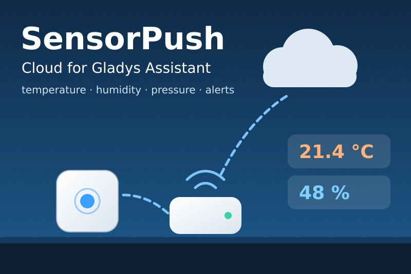
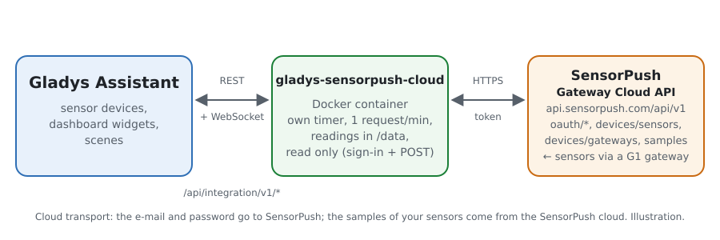
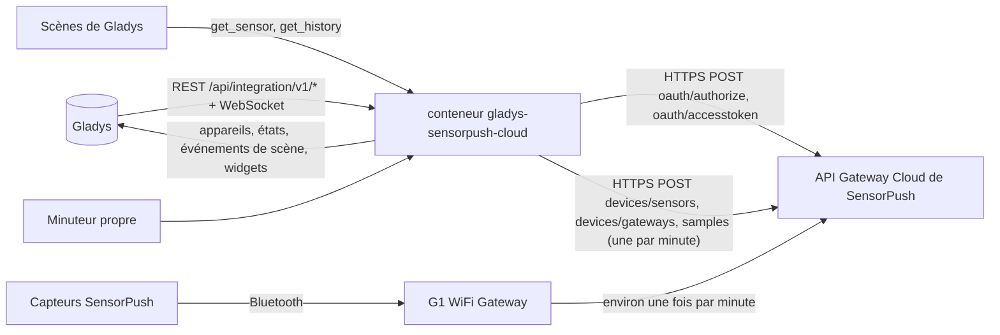
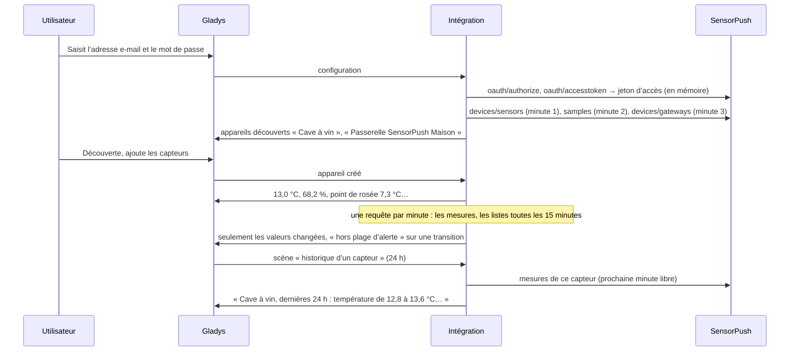
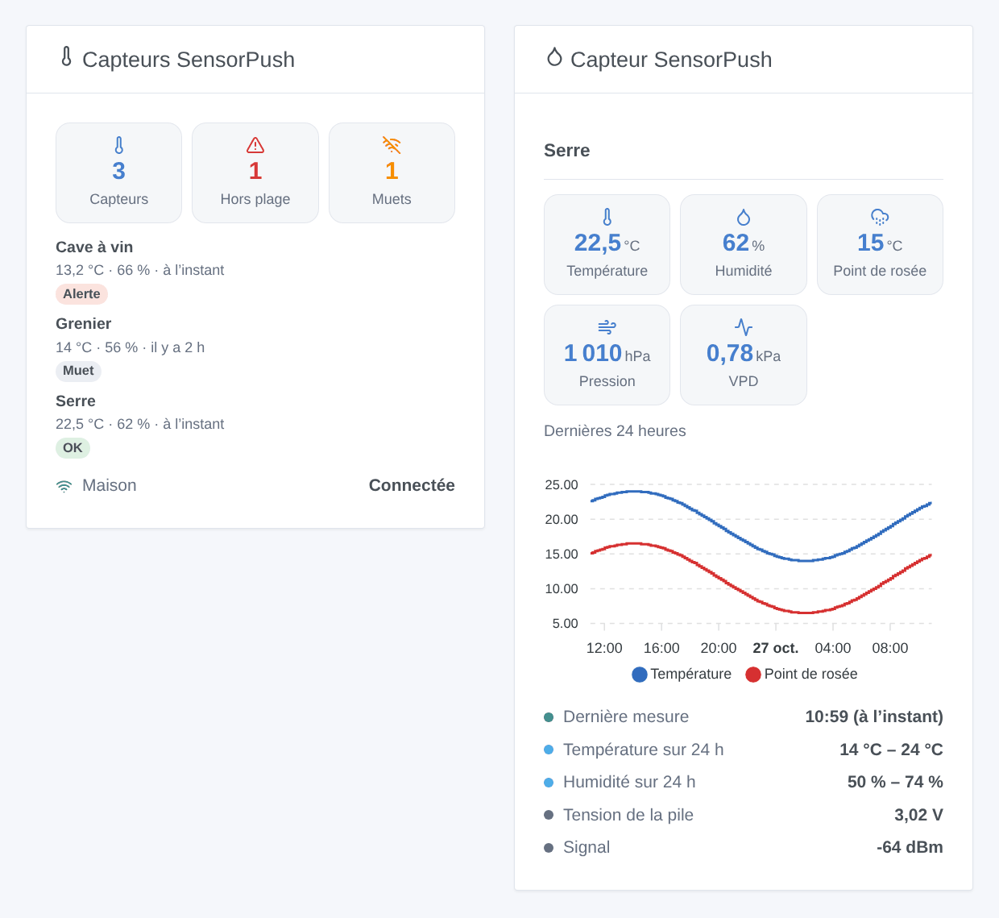

# Gladys SensorPush Cloud

[English](README.md) · **Français** · [Deutsch](README.de.md) · [Español](README.es.md)

[](LICENSE)
[](https://github.com/William-De71/gladys-sensorpush-cloud/releases)
[](https://github.com/William-De71/gladys-sensorpush-cloud/actions/workflows/release.yml)
[](https://gladysassistant.com)



Intégration externe de [Gladys Assistant](https://gladysassistant.com) pour les capteurs de température et d’humidité **SensorPush**, via l’[API officielle Gateway Cloud de SensorPush](https://www.sensorpush.com/gateway-cloud-api) et l’adresse e-mail et le mot de passe de votre compte SensorPush. Elle affiche dans Gladys la température, l’humidité, le point de rosée, la pression et le VPD de chaque capteur, indique si chaque passerelle est en ligne, et déclenche des scènes quand une valeur sort de la plage d’alerte réglée dans l’application SensorPush, qu’un capteur devient muet ou qu’une passerelle décroche — en lecture seule.

Documentation utilisateur : [English](docs/en.md) · [Français](docs/fr.md) · [Deutsch](docs/de.md) · [Español](docs/es.md).

Non affiliée à SensorPush. **Pas encore testée avec un vrai compte SensorPush** : les requêtes, les champs et les unités suivent la définition Swagger officielle ; les réponses à un compte inconnu, à un mot de passe trop court et à un mauvais jeton ont été vérifiées en direct.

## Fonctionnalités

- Chaque **capteur actif** du compte (HT1, HT.w, HTP.xw) et chaque **passerelle**, trouvés tout seuls.
- **Un appareil par capteur** : température, humidité, point de rosée, pression atmosphérique (HTP.xw) et déficit de pression de vapeur (VPD), convertis depuis les °F et les inHg ; **un appareil par passerelle** : sa connexion et sa version logicielle.
- **7 déclencheurs de scène** (hors plage d’alerte, retour dans la plage, capteur muet, capteur de retour, passerelle déconnectée, passerelle reconnectée, accès refusé), **2 actions de scène** (valeurs d’un capteur, historique d’un capteur sur 1 à 72 heures) et **2 widgets** (tous les capteurs d’un coup d’œil, un capteur avec une courbe sur 24 heures).
- **Jamais plus d’une requête par minute**, la limite documentée par SensorPush ; les dernières mesures toutes les minutes par défaut.
- **Lecture seule** : une connexion, puis uniquement des requêtes de lecture ; rien n’est jamais modifié dans le compte SensorPush. Le mot de passe et le jeton ne sont jamais écrits dans `/data`.
- Quatre langues partout : anglais, français, allemand, espagnol.

## Fonctionnement





Du compte à une scène :



### Transport

`transports: ["cloud"]` : tout passe par le cloud SensorPush (`api.sensorpush.com`), qui reçoit les mesures des capteurs par la passerelle. **L’adresse e-mail et le mot de passe quittent votre réseau** (vers SensorPush seulement, pour la connexion) ; les mesures de vos capteurs viennent de SensorPush. `/data` garde une empreinte de l’adresse e-mail, les capteurs, les passerelles, leurs dernières mesures, un point toutes les 10 minutes sur 24 heures pour la courbe, et ce que savent les déclencheurs — jamais le mot de passe ni le jeton.

## Appareils et fonctionnalités

| Appareil          | Fonctionnalités (catégorie / type)                                                                                                                                                                                                                                  |
| ----------------- | ------------------------------------------------------------------------------------------------------------------------------------------------------------------------------------------------------------------------------------------------------------------- |
| Un par capteur    | Température (`temperature-sensor` / `decimal`, °C), humidité (`humidity-sensor` / `decimal`, %), point de rosée (`temperature-sensor` / `probe`, °C), pression atmosphérique (`pressure-sensor` / `decimal`, hPa, HTP.xw), VPD (`pressure-sensor` / `decimal`, kPa) |
| Un par passerelle | Connexion et version (`text` / `text`)                                                                                                                                                                                                                              |

- SensorPush donne des °F et des inHg : l’intégration les convertit en °C et en hPa, et Gladys les affiche dans les unités de chaque utilisateur.
- Le point de rosée est une température `probe` (sonde) : il ne compte pas dans la température moyenne de la pièce.
- Les capteurs plus anciens ne donnent ni point de rosée ni VPD, seul le HTP.xw a un baromètre : une fonctionnalité apparaît avec sa première valeur, puis reste.
- La tension de la pile et le signal (dBm) n’ont pas de catégorie adaptée dans le cœur (la batterie est un pourcentage, le signal une qualité de 0 à 5) : le widget du capteur et l’action de scène les montrent.
- Une passerelle est connectée tant qu’elle s’est signalée au cloud dans les 30 dernières minutes (SensorPush conseille de lire `last_seen` environ toutes les 15 minutes).
- Les external ids reposent sur l’identifiant du capteur et la clé de la passerelle (`ext:…:sensor:16855-27453475893` : un point devient un tiret).

## Déclencheurs, actions de scène et widgets



**Widgets** : Capteurs SensorPush (combien de capteurs, hors plage, muets ; une carte par capteur, les alertes d’abord, avec température, humidité et âge de la dernière mesure ; les passerelles) et Capteur SensorPush (ses mesures, la température et le point de rosée des dernières 24 heures, le minimum et le maximum du jour, ses plages d’alerte, la tension de la pile et le signal). Les deux suivent les unités de l’utilisateur qui les regarde.

**Déclencheurs** (un événement par transition, jamais à la première lecture, jamais à la suite d’une action) :

- **hors plage d’alerte** / **retour dans la plage** : la température ou l’humidité franchit la plage d’alerte réglée dans l’application SensorPush (filtres : capteur, mesures, côté) ; variables : la valeur, son unité, la plage, le côté, la durée passée dehors ;
- **capteur muet** / **capteur de retour** : aucune nouvelle mesure pendant le délai de la configuration (30 minutes par défaut), puis de nouveau des mesures, avec la durée ;
- **passerelle déconnectée** / **passerelle reconnectée** : aucun signal pendant 30 minutes, puis de nouveau un signal (filtre : passerelle) ;
- **accès refusé** : SensorPush refuse l’adresse e-mail, le mot de passe ou le jeton — une fois par refus.

Les valeurs sont des fonctionnalités d’appareil : « humidité au-dessus de 70 % » est un déclencheur d’appareil de Gladys, avec votre propre seuil.

**Actions** :

- **valeurs d’un capteur** : les dernières valeurs, la tension de la pile, le signal et une phrase, depuis la dernière lecture (sans requête).
- **historique d’un capteur** : température et humidité minimales, maximales et moyennes sur les dernières 1 à 72 heures, en une requête envoyée dans la prochaine minute libre.

Pas fait, volontairement : aucune écriture (Gladys n’a pas besoin des étiquettes de l’API), pas de rapports en masse (envoyés par e-mail par SensorPush), pas de fonctionnalité pour la tension de la pile (aucune catégorie dans le cœur).

Exemples :

- Quand **SensorPush : hors plage d’alerte** sur la cave à vin → envoyer « {{triggerEvent.data.sensor_name}} : {{triggerEvent.data.measure_label}} {{triggerEvent.data.value}} {{triggerEvent.data.unit}} ».
- Chaque jour à 8 h → **SensorPush : historique d’un capteur** (serre, 24 h) → envoyer sa phrase de synthèse.
- Quand **SensorPush : passerelle déconnectée** → envoyer « La passerelle SensorPush {{triggerEvent.data.gateway_name}} est hors ligne ».

## Prérequis

- Gladys Assistant **5.3.0** ou plus récent (widgets et scènes des intégrations, mots-clés du catalogue de Gladys 5.3) : les instances plus anciennes ne peuvent pas installer l’intégration.
- Un compte SensorPush avec au moins un capteur et une **passerelle SensorPush** (G1 WiFi Gateway) : sans elle, les mesures n’arrivent jamais dans le cloud.
- **L’accès à l’API activé** : connectez-vous une fois au [Gateway Cloud Dashboard](https://dashboard.sensorpush.com/) et acceptez les conditions de l’API.
- Internet : l’intégration ne parle qu’à `api.sensorpush.com`.

### Le rythme de l’API

SensorPush documente « pas plus d’une requête par minute ». L’intégration espace chaque requête de données d’au moins 61 secondes : la dernière mesure de chaque capteur à l’intervalle de la configuration (toutes les minutes par défaut, une seule requête pour tous), la liste des capteurs et des passerelles toutes les 15 minutes, chacune à la place d’une lecture des mesures, et l’action d’historique dans la prochaine minute libre. Les deux requêtes de connexion n’arrivent que quand le jeton d’accès expire (son `exp`, une heure). Après un 429, un 5xx ou une absence de réponse, toutes les requêtes attendent 2 minutes, puis le double jusqu’à 30 minutes (ou le Retry-After).

## Installation

- **Depuis le store** : Intégrations → SensorPush Cloud → Installer.
- **Depuis l’URL du dépôt** : Intégrations → intégration externe → `https://github.com/William-De71/gladys-sensorpush-cloud`.
- **Mode développeur** : lancez `npm start` avec les variables données par Gladys (voir Développement).

## Configuration

| Champ ou bouton                  | Par défaut  | Signification                                                                                 |
| -------------------------------- | ----------- | --------------------------------------------------------------------------------------------- |
| Adresse e-mail                   | —           | Obligatoire : l’e-mail du compte SensorPush                                                   |
| Mot de passe                     | —           | Obligatoire, un secret : jamais réaffiché, jamais journalisé, jamais écrit dans `/data`       |
| Lecture des mesures              | 1 min       | 1, 2, 5 ou 10 min : une seule requête pour tous les capteurs                                  |
| Capteur muet après               | 30 min      | 15, 30, 60, 120 ou 360 min sans nouvelle mesure                                               |
| Unités des scènes                | métrique    | Métrique (°C, hPa) ou US (°F, inHg) pour les valeurs et textes des scènes                     |
| Langue des textes                | automatique | Noms des fonctionnalités, état des passerelles, textes des scènes et erreurs                  |
| Tester la connexion / Diagnostic | —           | Une connexion et la liste des capteurs ; l’état dans les journaux, sans mot de passe ni jeton |

## Utilisation

1. Connectez-vous une fois au Gateway Cloud Dashboard et acceptez les conditions de l’API (une fois par compte).
2. Dans Gladys (Intégrations → SensorPush Cloud → Configuration) : saisissez l’adresse e-mail et le mot de passe ; cliquez sur **Tester la connexion**.
3. **Découverte**, puis ajoutez vos capteurs et passerelles comme appareils.
4. Ajoutez les widgets à un tableau de bord, construisez des scènes avec les fonctionnalités, les déclencheurs et les actions.

## Développement

```bash
npm install
npm test                       # node --test, un faux SensorPush (fetch en mémoire, fausse horloge), jamais le réseau
npm run lint                   # ESLint
npm run format:check           # Prettier
npx github:GladysAssistant/integration-store . --skip-image-check
scripts/build-cover.sh         # cover.jpg depuis docs/assets/cover.svg
docs/illustrations/render.sh   # docs/assets/widgets.<langue>.png
```

En local, le SDK lit `GLADYS_HOST_API_URL`, `GLADYS_INTEGRATION_TOKEN` et `GLADYS_INTEGRATION_SELECTOR` (donnés par Gladys en mode développeur), et l’intégration lit `TZ`. `DEBUG=gladys-integration-sdk` affiche les journaux du SDK.

Les tests couvrent le client HTTP (la connexion, les refus vus en direct, une nouvelle connexion pour un jeton refusé, les pauses, une requête de données par minute), les lecteurs de réponses et les conversions d’unités, les déclencheurs, les appareils (les champs qu’exige l’écran de découverte, les couples catégorie / type du cœur), les widgets (`validateWidgetContent`), le manifeste, les quatre langues, le script de release, et toute l’intégration face au faux Gladys du SDK et à un faux SensorPush sur une heure simulée. `test/structure.test.js` fige chaque clé que les utilisateurs enregistrent.

## Processus de release


Chaque fusion sur `main` lance la CI, puis calcule la version depuis les [Conventional Commits](https://www.conventionalcommits.org/) depuis le dernier tag : `feat` → mineure, `fix` / `perf` → correctif, `!` ou `BREAKING CHANGE` → majeure (une mineure sous 1.0.0) ; `docs`, `chore`, `ci`, `test`, `style`, `refactor`, `build` seuls ne publient rien. La section du changelog est générée, le tag poussé, l’image multi-architecture construite, puis `main` reçoit le commit de release, la GitHub Release est créée et un dernier job vérifie l’image publique, le validateur du store et le topic.

- Le titre de la pull request devient le commit squash, puis la ligne du changelog : écrivez-le en anglais, pour l’utilisateur (`pr-title.yml` le vérifie). Ne modifiez jamais `CHANGELOG.md` à la main.
- La 1.0.0 est une décision : Actions → Release → Run workflow avec `release-as: 1.0.0`. `dry-run` montre la version et les notes sans rien publier.
- **Branche protégée** : la release pousse son commit sur `main` avec `GITHUB_TOKEN`. Le ruleset `protect-main` (ni suppression, ni force-push) le laisse passer ; une règle plus stricte (pull request obligatoire, status checks) demanderait d’ajouter GitHub Actions aux contournements, ou une GitHub App.
- Après la première release, rendez public le paquet `ghcr.io` (Package settings → Change visibility), sinon Gladys ne peut pas le télécharger.

## Dépannage

Voir [docs/fr.md](docs/fr.md#dépannage). Signalez les problèmes avec les versions de Gladys et de l’intégration, vos modèles de capteurs et de passerelle, le message de **Tester la connexion** et le résultat de **Diagnostic** (dans les journaux de l’intégration). Ne collez jamais votre mot de passe.

## Contribuer

Les tickets et pull requests sont les bienvenus. Lancez `npm run format:check && npm run lint && npm test` avant d’ouvrir une pull request, et gardez inchangés chaque external id et chaque clé enregistrée (voir [CLAUDE.md](CLAUDE.md)).

## Sécurité

Voir [SECURITY.md](SECURITY.md) : signalez les vulnérabilités en privé. Le mot de passe est un champ `secret` : jamais journalisé, jamais écrit dans `/data`, envoyé uniquement à `api.sensorpush.com`, pour la connexion. Le jeton d’accès reste en mémoire, n’est jamais journalisé et n’est envoyé qu’à `api.sensorpush.com`. `/data/sensorpush.json` est écrit en mode 0600.

## Captures à venir

Les images ci-dessus sont des illustrations, pas des captures d’écran. Les vraies captures iront dans `docs/assets/screenshots/` (PNG, 1280 × 800) : `configuration.png`, `discovery.png` (les capteurs et passerelles proposés), `device.png` (un capteur avec ses fonctionnalités), `scene-out-of-range.png` (une scène sur le déclencheur « hors plage d’alerte »), `dashboard.png` (les deux widgets avec de vrais capteurs).

## Licence

[Licence Apache 2.0](LICENSE) — voir aussi [NOTICE](NOTICE). SensorPush est une marque de son propriétaire. Merci à la documentation et au SDK de Gladys, à SensorPush pour la définition publique de son API, et aux auteurs de l’intégration « SensorPush Cloud » de Home Assistant.
