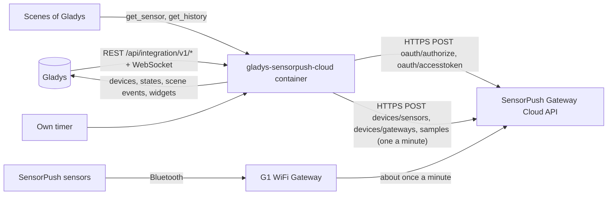
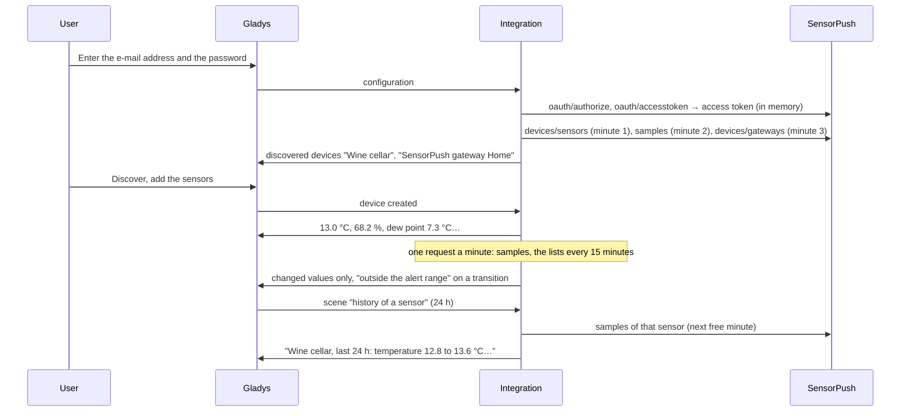
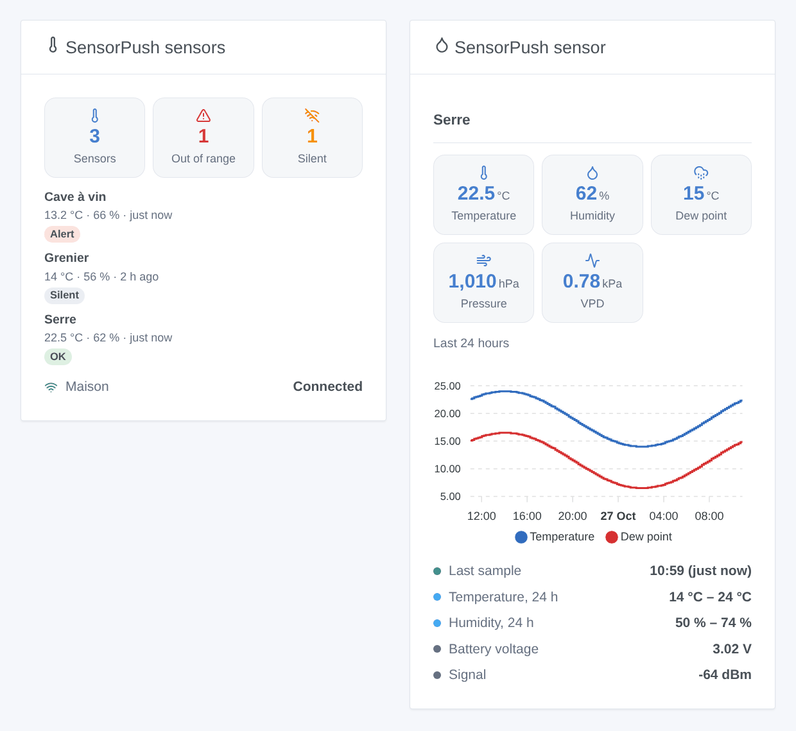

# Gladys SensorPush Cloud

**English** · [Français](README.fr.md) · [Deutsch](README.de.md) · [Español](README.es.md)

[](LICENSE)
[](https://github.com/William-De71/gladys-sensorpush-cloud/releases)
[](https://github.com/William-De71/gladys-sensorpush-cloud/actions/workflows/release.yml)
[](https://gladysassistant.com)


[Gladys Assistant](https://gladysassistant.com) external integration for **SensorPush** temperature and humidity sensors, through the official [SensorPush Gateway Cloud API](https://www.sensorpush.com/gateway-cloud-api) and the e-mail address and password of your SensorPush account. It shows the temperature, humidity, dew point, pressure and VPD of each sensor in Gladys, whether each gateway is online, and fires scenes when a value leaves the alert range set in the SensorPush app, a sensor goes silent or a gateway drops — read only.

User documentation: [English](docs/en.md) · [Français](docs/fr.md) · [Deutsch](docs/de.md) · [Español](docs/es.md).

Not affiliated with SensorPush. **Not tested with a real SensorPush account yet**: the requests, fields and units follow the official Swagger definition; the answers to an unknown account, a short password and a wrong token were checked live.

## Features

- Every **active sensor** of the account (HT1, HT.w, HTP.xw) and every **gateway**, found by itself.
- **One device per sensor**: temperature, humidity, dew point, barometric pressure (HTP.xw) and vapour pressure deficit (VPD), converted from °F and inHg; **one device per gateway**: its connection and software version.
- **7 scene triggers** (outside the alert range, back in the alert range, sensor silent, sensor back, gateway disconnected, gateway reconnected, access refused), **2 scene actions** (values of a sensor, history of a sensor over 1 to 72 hours) and **2 dashboard widgets** (every sensor at a glance, one sensor with a 24-hour chart).
- **Never more than one request a minute**, the limit SensorPush documents; the last samples every minute by default.
- **Read only**: a sign-in, then reading requests only; nothing is ever changed in the SensorPush account. The password and the token are never written to `/data`.
- Four languages everywhere: English, French, German, Spanish.

## How it works




From the account to a scene:



### Transport

`transports: ["cloud"]`: everything goes through the SensorPush cloud (`api.sensorpush.com`), which receives the samples of the sensors through the gateway. **The e-mail address and the password leave your network** (to SensorPush only, to sign in); the samples of your sensors come from SensorPush. `/data` keeps a fingerprint of the e-mail address, the sensors, the gateways, their last samples, one point every 10 minutes over 24 hours for the chart, and what the triggers know — never the password nor the token.

## Devices and features

| Device          | Features (category / type)                                                                                                                                                                                                                                  |
| --------------- | ----------------------------------------------------------------------------------------------------------------------------------------------------------------------------------------------------------------------------------------------------------- |
| One per sensor  | Temperature (`temperature-sensor` / `decimal`, °C), humidity (`humidity-sensor` / `decimal`, %), dew point (`temperature-sensor` / `probe`, °C), barometric pressure (`pressure-sensor` / `decimal`, hPa, HTP.xw), VPD (`pressure-sensor` / `decimal`, kPa) |
| One per gateway | Connection and version (`text` / `text`)                                                                                                                                                                                                                    |

- SensorPush gives °F and inHg: the integration converts them to °C and hPa, and Gladys shows them in the units of each user.
- The dew point is a `probe` temperature: it does not count in the average temperature of the room.
- Older sensors give no dew point nor VPD, only the HTP.xw has a barometer: a feature appears with its first value, then stays.
- The battery voltage and the signal (dBm) have no fitting category in the core (the battery is a percentage, the signal a 0–5 quality): the sensor widget and the scene action show them.
- A gateway is connected while it checked in with the cloud in the last 30 minutes (SensorPush advises reading `last_seen` about every 15 minutes).
- External ids rest on the id of the sensor and the key of the gateway (`ext:…:sensor:16855-27453475893`: a dot becomes a dash).

## Scene triggers, actions and widgets



**Widgets**: SensorPush sensors (how many sensors, outside their range, silent; one card per sensor, the alerts first, with temperature, humidity and the age of the last sample; the gateways) and SensorPush sensor (its measures, the temperature and dew point of the last 24 hours, the lowest and highest of the day, its alert ranges, battery voltage and signal). Both follow the units of the user who looks at them.

**Triggers** (one event per transition, never at the first reading, never as the result of an action):

- **outside the alert range** / **back in the alert range**: the temperature or the humidity crosses the alert range set in the SensorPush app (filters: sensor, measures, side); variables: the value, its unit, the range, the side, how long it was outside;
- **sensor silent** / **sensor back**: no new sample for the delay of the configuration (30 minutes by default), then samples again, with how long it lasted;
- **gateway disconnected** / **gateway reconnected**: no check-in for 30 minutes, then a check-in again (filter: gateway);
- **access refused**: SensorPush refuses the e-mail address, the password or the token — once per refusal.

The values are device features: "humidity above 70 %" is a device trigger of Gladys, with your own threshold.

**Actions**:

- **values of a sensor**: the last values, battery voltage, signal and a sentence, from the last reading (no request).
- **history of a sensor**: minimum, maximum and average temperature and humidity over the last 1 to 72 hours, in one request sent in the next free minute.

Not done, on purpose: no write (the tags of the API are not needed by Gladys), no bulk reports (sent by e-mail by SensorPush), no device for the battery voltage (no category in the core).

Examples:

- When **SensorPush: outside the alert range** on the wine cellar → send "{{triggerEvent.data.sensor_name}}: {{triggerEvent.data.measure_label}} {{triggerEvent.data.value}} {{triggerEvent.data.unit}}".
- Every day at 8:00 → **SensorPush: history of a sensor** (greenhouse, 24 h) → send its summary.
- When **SensorPush: gateway disconnected** → send "The SensorPush gateway {{triggerEvent.data.gateway_name}} is offline".

## Requirements

- Gladys Assistant **5.3.0** or later (widgets and scenes of integrations, catalog keywords of Gladys 5.3): older instances cannot install the integration.
- A SensorPush account with at least one sensor and a **SensorPush gateway** (G1 WiFi Gateway): without it, the samples never reach the cloud.
- **The API access activated**: log in once to the [Gateway Cloud Dashboard](https://dashboard.sensorpush.com/) and accept the terms of the API.
- The internet: the integration talks to `api.sensorpush.com` only.

### The pace of the API

SensorPush documents "no more than one request per minute". The integration keeps every data request 61 seconds apart at least: the last sample of every sensor at the interval of the configuration (every minute by default, one request for all), the list of the sensors and the gateways every 15 minutes, each in place of a sample reading, and the history action in the next free minute. The two sign-in requests come only when the access token expires (its `exp`, one hour). After a 429, a 5xx or no answer, every request waits 2 minutes, doubling up to 30 minutes (or the Retry-After).

## Installation

- **From the store**: Integrations → SensorPush Cloud → Install.
- **From the repository URL**: Integrations → external integration → `https://github.com/William-De71/gladys-sensorpush-cloud`.
- **Developer mode**: run `npm start` with the variables given by Gladys (see Development).

## Configuration

| Field or button                  | Default   | Meaning                                                                                  |
| -------------------------------- | --------- | ---------------------------------------------------------------------------------------- |
| E-mail address                   | —         | Required: the e-mail of the SensorPush account                                           |
| Password                         | —         | Required, a secret: never shown again, never logged, never written to `/data`            |
| Reading of the samples           | 1 min     | 1, 2, 5 or 10 min: one request for every sensor                                          |
| Sensor silent after              | 30 min    | 15, 30, 60, 120 or 360 min without a new sample                                          |
| Units of the scenes              | metric    | Metric (°C, hPa) or US (°F, inHg) for the scene values and texts                         |
| Language of the texts            | automatic | Feature names, gateway state, scene texts and errors                                     |
| Test the connection / Diagnostic | —         | A sign-in and the list of the sensors; the state in the logs, without password nor token |

## Usage

1. Log in once to the Gateway Cloud Dashboard and accept the API terms (once per account).
2. In Gladys (Integrations → SensorPush Cloud → Configuration): enter the e-mail address and the password; press **Test the connection**.
3. **Discover**, then add your sensors and gateways as devices.
4. Add the widgets to a dashboard, build scenes with the features, the triggers and the actions.

## Development

```bash
npm install
npm test                       # node --test, a fake SensorPush (in-memory fetch, fake clock), never the network
npm run lint                   # ESLint
npm run format:check           # Prettier
npx github:GladysAssistant/integration-store . --skip-image-check
scripts/build-cover.sh         # cover.jpg from docs/assets/cover.svg
docs/illustrations/render.sh   # docs/assets/widgets.<lang>.png
```

Locally, the SDK reads `GLADYS_HOST_API_URL`, `GLADYS_INTEGRATION_TOKEN` and `GLADYS_INTEGRATION_SELECTOR` (given by Gladys in developer mode), and the integration reads `TZ`. `DEBUG=gladys-integration-sdk` shows the SDK logs.

The tests cover the HTTP client (the sign-in, the refusals seen live, one new sign-in for a refused token, the pauses, one data request a minute), the parsers and the unit conversions, the triggers, the devices (the fields the Discovery screen requires, the category / type pairs of the core), the widgets (`validateWidgetContent`), the manifest, the four languages, the release script, and the whole integration against the fake Gladys of the SDK and a fake SensorPush over a simulated hour. `test/structure.test.js` freezes every key users store.

## Release process


Every merge on `main` runs the CI, then computes the version from the [Conventional Commits](https://www.conventionalcommits.org/) since the last tag: `feat` → minor, `fix` / `perf` → patch, `!` or `BREAKING CHANGE` → major (a minor below 1.0.0); `docs`, `chore`, `ci`, `test`, `style`, `refactor`, `build` alone publish nothing. The changelog section is generated, the tag pushed, the multi-architecture image built, then `main` receives the release commit, the GitHub Release is created and a last job checks the public image, the store validator and the topic.

- The pull request title becomes the squash commit, then the changelog line: write it in English, for the user (`pr-title.yml` checks it). Never edit `CHANGELOG.md` by hand.
- 1.0.0 is a decision: Actions → Release → Run workflow with `release-as: 1.0.0`. `dry-run` shows the version and the notes without publishing.
- **Protected branch**: the release pushes its commit to `main` with `GITHUB_TOKEN`. The `protect-main` ruleset (no deletion, no force-push) lets it through; a stricter rule (pull request required, status checks) would need GitHub Actions in its bypass list, or a GitHub App.
- After the first release, make the `ghcr.io` package public (Package settings → Change visibility), or Gladys cannot pull it.

## Troubleshooting

See [docs/en.md](docs/en.md#troubleshooting). Report issues with the versions of Gladys and of the integration, your sensor models and gateway, the message of **Test the connection** and the result of **Diagnostic** (in the logs of the integration). Never paste your password.

## Contributing

Issues and pull requests are welcome. Run `npm run format:check && npm run lint && npm test` before opening a pull request, and keep every external id and stored key unchanged (see [CLAUDE.md](CLAUDE.md)).

## Security

See [SECURITY.md](SECURITY.md): report vulnerabilities privately. The password is a `secret` field: never logged, never written to `/data`, sent to `api.sensorpush.com` only, to sign in. The access token stays in memory, is never logged and is sent to `api.sensorpush.com` only. `/data/sensorpush.json` is written with mode 0600.

## Screenshots to come

The images above are illustrations, not screenshots. Real screenshots will go in `docs/assets/screenshots/` (PNG, 1280 × 800): `configuration.png`, `discovery.png` (the sensors and gateways offered), `device.png` (a sensor with its features), `scene-out-of-range.png` (a scene on the "outside the alert range" trigger), `dashboard.png` (the two widgets with real sensors).

## License

[Apache License 2.0](LICENSE) — see also [NOTICE](NOTICE). SensorPush is a trademark of its owner. Thanks to the Gladys documentation and SDK, to SensorPush for its public API definition, and to the authors of the Home Assistant "SensorPush Cloud" integration.
